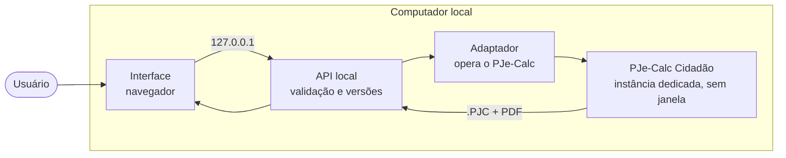

# PJE Calc Fácil

Interface web e API local para o **PJe-Calc Cidadão**, o sistema oficial de cálculos trabalhistas da Justiça do Trabalho.

O projeto oferece um assistente de preenchimento mais simples que as telas originais e delega a liquidação ao próprio
PJe-Calc, instalado na mesma máquina. Valores, relatório em PDF e arquivo `.PJC` são sempre produzidos pelo programa oficial.

> Projeto independente, sem vínculo com o CSJT, o TST ou o TRT da 8ª Região.

## Status

Versão **0.1** (protótipo).

| Componente | Situação |
|---|---|
| Interface | Funcional: cadastro, edição por etapas, validação contínua e revisão |
| API local | Funcional: cálculos versionados, validação, catálogos |
| Adaptador do PJe-Calc | Funcional pela linha de comando: inicia o PJe-Calc sem janela e liquida um `.PJC` (PDF, HTML e `.PJC` oficiais) |
| Integração da API com o adaptador | Em desenvolvimento |
| Instalador para Windows | Planejado |

Enquanto a API não estiver ligada ao adaptador, liquidar pela interface valida o cálculo e informa que o PJe-Calc não
está conectado; a liquidação de um `.PJC` já funciona pela linha de comando (`npm run motor`).

## Arquitetura



| Componente | Descrição | Pasta |
|---|---|---|
| Interface | Aplicação web com assistente por etapas. Não executa cálculos. | [`interface/`](interface/) |
| API | Servidor local que recebe a especificação do cálculo em JSON, valida, mantém o histórico de versões e solicita a liquidação. | [`api/`](api/) |
| Motor | Instância dedicada do PJe-Calc oficial e o adaptador que a opera. | [`motor/`](motor/) |
| Contratos | OpenAPI da API e JSON Schema da especificação de cálculo. | [`contratos/`](contratos/) |
| Instalador | Instalação para Windows (planejado). | [`instalador/`](instalador/) |
| Documentação | Estudo do PJe-Calc, arquitetura e decisões. | [`docs/`](docs/) |

## Requisitos

- Node.js 22.13 ou superior (recomendado: 22 LTS)
- Google Chrome ou Microsoft Edge
- Para liquidar: Windows, PJe-Calc Cidadão 2.16.x e a cópia dedicada descrita em [`motor/runtime`](motor/runtime/README.md)

## Instalação

```bash
git clone <url-do-repositório> "PJE Calc"
cd "PJE Calc"
npm install
```

A pasta `node_modules` é específica de cada sistema operacional e não deve ser copiada entre máquinas; execute
`npm install` em cada uma.

## Uso

| Comando | Descrição |
|---|---|
| `npm run dev` | API (porta 8080) e interface com recarga automática (porta 5173). Acesse http://localhost:5173 |
| `npm run build` | Compila a interface e verifica os tipos da API |
| `npm start` | Executa a versão compilada em http://127.0.0.1:8080 |
| `npm test` | Testes da API e do adaptador (sem PJe-Calc) |
| `npm run motor -- <comando>` | Adaptador: `estado`, `iniciar`, `parar`, `liquidar arquivo.PJC --data AAAA-MM-DD` ([detalhes](motor/adaptador/README.md)) |
| `npm run test:regressao -w motor/adaptador` | Gabaritos contra o PJe-Calc real, conferidos ao centavo |

## Dados

Os cálculos são armazenados fora do repositório, em um banco SQLite local:

| Sistema | Pasta |
|---|---|
| Windows | `%LOCALAPPDATA%\PJECalcFacil\dados` |
| macOS | `~/Library/Application Support/PJECalcFacil/dados` |
| Linux | `~/.local/share/PJECalcFacil/dados` |

A pasta pode ser alterada pela variável `PJECALC_FACIL_DADOS`. Para transferir um cálculo entre computadores, use
**Baixar especificação (.json)** na etapa Liquidar e **Importar especificação** na lista de cálculos.

## Estrutura do repositório

```text
.
├── api/            API local (Fastify + SQLite)
├── interface/      Interface web (React + Vite)
├── contratos/      OpenAPI, JSON Schema e exemplos fictícios
├── motor/          Adaptador e instância dedicada do PJe-Calc
├── instalador/     Instalador para Windows
├── docs/           Documentação técnica e ADRs
└── infra/          Material arquivado para execução em servidor
```

## Documentação

- [Visão geral](docs/01-visao-geral.md)
- [Arquitetura](docs/05-arquitetura-proposta.md) e [decisões de arquitetura (ADRs)](docs/adr/README.md)
- [Funcionamento interno do PJe-Calc](docs/02-pjecalc-por-dentro/README.md)
- [Estratégias de integração](docs/04-estrategias-de-integracao.md) e [projetos relacionados](docs/03-projetos-existentes.md)
- [API](docs/06-api/README.md) e [interface](docs/07-interface/README.md)
- [Segurança e LGPD](docs/08-seguranca-e-lgpd.md) e [aspectos legais](docs/09-aspectos-legais.md)
- [Roadmap](docs/10-roadmap.md)

## Princípios

1. O cálculo é sempre realizado pelo PJe-Calc oficial; a aplicação prepara os dados, aciona o programa e confere o resultado.
2. A execução é exclusivamente local: a aplicação e o PJe-Calc atendem apenas em `127.0.0.1`.
3. O `.PJC` entregue é sempre o exportado pelo PJe-Calc após a liquidação.
4. A instalação original do PJe-Calc não é alterada; a aplicação utiliza uma cópia dedicada, em porta própria.
5. Binários do PJe-Calc e dados de clientes não são versionados.

## Licença

Projeto de uso pessoal, sem licença de distribuição. O PJe-Calc é de titularidade do TRT da 8ª Região e do CSJT e não é
distribuído com este repositório.
