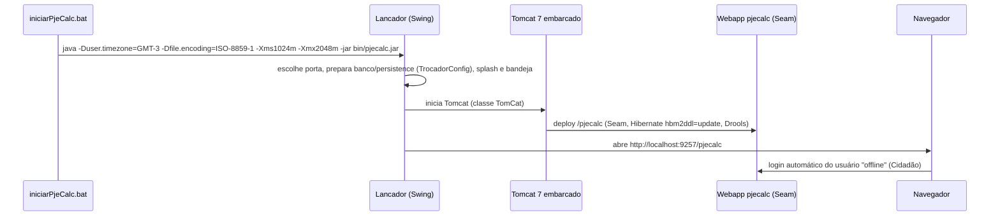
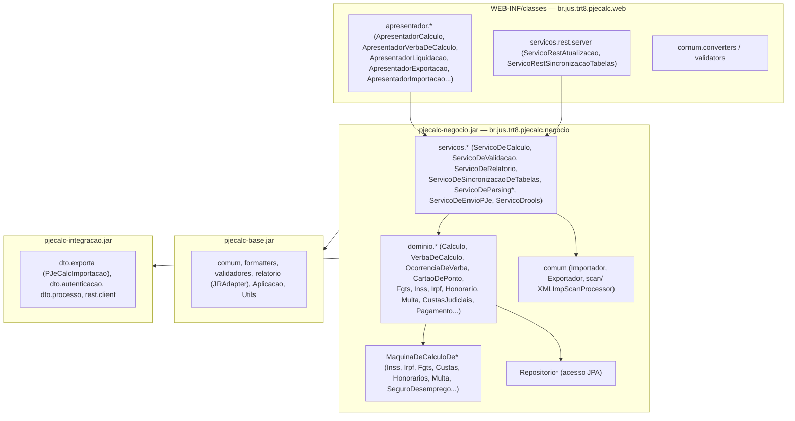

# Arquitetura do PJe-Calc Cidadão

## Estrutura de pastas da instalação

```text
pjecalc-windows64-<versão>/
├── iniciarPjeCalc.bat          # inicia a JVM do lançador (Windows)
├── bin/
│   ├── pjecalc.jar             # LANÇADOR (Swing): Main-Class br.jus.trt8.pjecalcsa.container.Lancador
│   ├── lib/                    # Tomcat 7.0.67 embarcado (catalina, coyote, jasper...), h2-1.3.154.jar
│   └── jre/                    # JRE 8 empacotada (Windows)
├── tomcat/
│   ├── conf/server.xml         # portas 9257 (HTTP), 9258 (AJP), 9256 (shutdown) — todas em 127.0.0.1
│   ├── logs/                   # logs do Tomcat (diagnóstico: OutOfMemory, banco fechado...)
│   └── webapps/pjecalc/        # A APLICAÇÃO (webapp descompactado)
│       ├── META-INF/context.xml        # DataSource jdbc/pjeCalcDS (H2)
│       ├── WEB-INF/
│       │   ├── web.xml, components.xml, pages.xml, faces-config.xml
│       │   ├── classes/br/jus/trt8/pjecalc/web/...   # camada web (Apresentadores)
│       │   ├── classes/pjecalc.validacao.pkg         # regras Drools de validação
│       │   ├── classes/pjecalc.justificativa.pkg     # regras Drools de justificativa
│       │   ├── classes/relatorios/                   # modelos JasperReports
│       │   └── lib/pjecalc-{base,negocio,integracao}-<versão>.jar + ~110 dependências
│       ├── pages/**.xhtml              # telas (Facelets)
│       └── template{CartaoDePonto,HistoricoSalarial,Ferias,Faltas}/  # CSVs de exemplo
└── .dados/pjecalc.h2.db         # BANCO (cálculos + tabelas)
```

## Como inicia



Pontos de atenção para rodar **sem tela** (servidor):

- O lançador usa Swing (janela, `JOptionPane`, bandeja) e trava num ambiente sem display.
- Há duas saídas conhecidas: (a) iniciar o Tomcat direto (`org.apache.catalina.startup.Bootstrap`), que é
  como faz o *pjecalc-agente*; (b) uma classe própria que repete os passos do lançador sem abrir janela,
  que é como faz o *PJeCalcMCP*. Ver [04](../04-estrategias-de-integracao.md).
- Parâmetros de JVM relevantes: `-Duser.timezone=GMT-3` (as datas do `.PJC` dependem disso),
  `-Dfile.encoding=ISO-8859-1`, `-Dseguranca.pjecalc.tokenServicos=<token>` (token dos serviços REST) e
  `-Dseguranca.pjekz.servico.contexto` (integração com o PJe).

## Pilha tecnológica (lida de `WEB-INF/lib`)

| Camada | Tecnologia | Versão | Situação |
|---|---|---|---|
| Runtime | Java | 8 | Obrigatório (11+ quebra) |
| Servidor | Apache Tomcat (embarcado) | 7.0.67 | **Fim de vida** desde 2021 |
| Framework | JBoss Seam | 2.2.0.GA | Descontinuado |
| UI | JSF (Mojarra) + Facelets | 1.2_13 / 1.1.15 | Descontinuado |
| UI/AJAX | RichFaces / Ajax4JSF | 3.3.4 | Descontinuado, **CVEs críticos conhecidos** |
| ORM | Hibernate Core / EntityManager | 3.3.2 / 3.4.0 | Descontinuado |
| Regras | Drools | 5.5.0.Final | Validação e justificativas do cálculo |
| Relatórios | JasperReports + iText | 3.7.6 / 2.1.7 | Saída PDF e HTML |
| REST | RESTEasy (Seam) + Jackson 1.x | 2.2.0 / 1.5.3 | Só serviços auxiliares |
| Banco | H2 | 1.3.154 (2011) | Embutido; na versão institucional, Oracle (`ojdbc14`) |
| Outros | Quartz 1.5, Groovy 1.8, XStream 1.1/1.3, commons-collections 3.1, BouncyCastle 1.38, Selenium 2.21, HtmlUnit 2.9 | — | Várias com vulnerabilidades conhecidas |

> A mesma base de código atende o **PJe-Calc Institucional** (Oracle, login por certificado ou PJe, papéis de
> servidor e magistrado em `papeis_permitidos.properties`). A versão Cidadão desliga isso e entra direto
> como usuário local.

## Camadas e pacotes



### Classes-chave (assinaturas públicas)

| Classe | Métodos relevantes | Uso para nós |
|---|---|---|
| `negocio.dominio.calculo.Calculo` | `liquidar()`, `validar()`, `isLiquidado()`, `calcularHashCodeDaLiquidacao()`, `getHashCodeLiquidacao()`, `isAlteradoParaLiquidacao()`, `gerarPeriodosDeFerias()` | O coração: a liquidação é um método da entidade |
| `negocio.servicos.ServicoDeCalculo` | `getInstancia()` (componente Seam), `abrirCalculo`, `importarCalculo(byte[])`, `exportarCalculo(...)`, `duplicarCalculo`, `salvarCalculoExterno` | Importar e exportar `.PJC` |
| `negocio.servicos.ServicoDeValidacao` | `validar()`, `getMensagens()`, `getTotalErro()`, `getTotalAlerta()` | "Pendências do cálculo" |
| `negocio.servicos.ServicoDeRelatorio` | `gerarRelatorio(TipoRelatorioEnum, Calculo, List, FormatoRelatorioEnum)` | Relatórios **PDF/HTML**: `DEMONSTRATIVO_CALCULO`, `PARAMETROS_CALCULO`, `CALCULO_CONSOLIDADO`, `PAGAMENTO_CONSOLIDADO` |
| `negocio.comum.Importador` | `importar(byte[])` → `Calculo` (via `XMLImpScanProcessor`, reflexão) | Leitor do `.PJC` |
| `web.apresentador.calculo.ApresentadorLiquidacao` | `iniciar()`, `liquidar()`, `getTelas()` | Botão "Liquidar" |

### Por que não "chamar `Calculo.liquidar()` direto"?

É tecnicamente possível rodar partes do motor sem Tomcat. O projeto *PJe-Calc Reborn* fez isso para
gerar valores de referência. O custo, porém, é alto: o domínio depende de **contexto Seam**
(`Component.getInstance`, `Contexts`), de **repositórios JPA** com *lazy loading*, de regras **Drools** e de
dezenas de *stubs* e chamadas por reflexão a métodos privados. Qualquer atualização do PJe-Calc pode
quebrar isso. Detalhes e comparação em [04](../04-estrategias-de-integracao.md).

## Enumerações úteis (lidas do bytecode)

- **Índices de correção** (`IndiceMonetarioEnum`): `INDICE_TRABALHISTA, TUACDT, TABELA_DEVEDOR_FAZENDA,
  TABELA_INDEBITO_TRIBUTARIO, TABELA_UNICA_JT_MENSAL, TABELA_UNICA_JT_DIARIO, TR, IGPM, INPC, IPC, IPCA, IPCAE,
  IPCAETR, JAM, SELIC, SELIC_FAZENDA, SELIC_BACEN, SEM_CORRECAO`
- **Juros** (`JurosEnum`): `JUROS_PADRAO, JUROS_POUPANCA, FAZENDA_PUBLICA, JUROS_MEIO_PORCENTO, JUROS_UM_PORCENTO,
  JUROS_ZERO_TRINTA_TRES, SELIC, SELIC_FAZENDA, SELIC_BACEN, TRD_SIMPLES, TRD_COMPOSTOS, TAXA_LEGAL, SEM_JUROS`
- **Relatórios** (`TipoRelatorioEnum` × `FormatoRelatorioEnum`): 4 tipos × `PDF | HTML`

> ⚠️ *a verificar a cada versão:* as enumerações mudam entre versões. A API deve lê-las do motor em execução,
> e não fixá-las no código.
