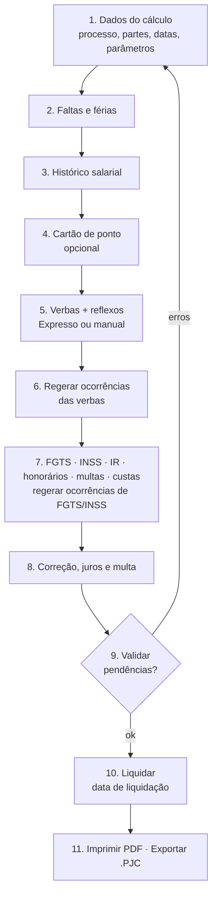

# Telas e fluxo de trabalho

O PJe-Calc é organizado em **menus laterais** (abas do cálculo) e **operações**. Cada tela é um `.xhtml`
servido como `.jsf`, controlado por um `Apresentador*` (componente Seam).

## Mapa das telas do cálculo

| Grupo (menu) | Tela | Arquivo `pages/...` | Seção da especificação na API |
|---|---|---|---|
| Cálculo | Dados do processo / parâmetros do cálculo | `calculo/calculo.xhtml` | `processo`, `partes`, `contrato`, `parametros` |
| | Faltas | `calculo/falta.xhtml` | `faltas[]` |
| | Férias | `calculo/ferias.xhtml` | `ferias[]` |
| | Histórico salarial | `calculo/historico-salarial.xhtml` | `historicoSalarial[]` |
| | Verbas (lista, Expresso, manual, reflexos) | `calculo/verba/verbas-para-calculo.xhtml`, `verba-calculo.xhtml`, `verba/verba-no-calculo*.xhtml` | `verbas[]` |
| | Ocorrências da verba | `calculo/parametrizar-ocorrencia.xhtml` | `verbas[].ocorrencias[]` |
| | Cartão de ponto (quantidades / apuração por jornada) | `cartaodeponto/cartaodeponto.xhtml`, `apuracao-cartaodeponto.xhtml` | `cartaoDePonto` |
| | FGTS | `calculo/fgts.xhtml`, `parametrizar-fgts.xhtml` | `fgts` |
| | Contribuição social (INSS) | `calculo/inss/*.xhtml` | `contribuicaoSocial` |
| | Imposto de renda | `calculo/irpf.xhtml` | `impostoDeRenda` |
| | Previdência privada | `calculo/previdencia-privada.xhtml` | `previdenciaPrivada` |
| | Pensão alimentícia | `calculo/pensao-alimenticia.xhtml` | `pensaoAlimenticia` |
| | Salário-família | `calculo/salario-familia.xhtml` | `salarioFamilia` |
| | Seguro-desemprego | `calculo/seguro-desemprego.xhtml` | `seguroDesemprego` |
| | Multas e indenizações | `calculo/multas-indenizacoes.xhtml` | `multas[]` |
| | Honorários | `calculo/honorarios.xhtml` | `honorarios[]` |
| | Custas judiciais | `calculo/custas-judiciais.xhtml` | `custas` |
| | Correção, juros e multa | `calculo/parametros-atualizacao/parametros-atualizacao.xhtml` | `correcaoJurosMulta` |
| Operações | Validação (pendências) | `calculo/validacao.xhtml` | `POST /validacoes` |
| | Liquidar | `calculo/liquidacao.xhtml` | `POST /liquidacoes` |
| | Imprimir (relatório) | `calculo/relatorio/relatorio-calculo.xhtml`, `resumo-calculo.xhtml` | `GET /relatorios/{tipo}` |
| | Exportar `.PJC` | `calculo/exportacao.xhtml` | `GET /arquivo-pjc` |
| | Importar `.PJC` | `importacao/importacao.xhtml` | `POST /importacoes` |
| Execução | Pagamentos / atualização | `pagamento/*.xhtml`, `calculo/parcelas-atualizaveis.xhtml` | `POST /atualizacoes` |
| | Cálculo externo | `calculo/calculo-externo.xhtml` | `POST /calculos-externos` |
| Tabelas | Índices, juros, INSS, IRPF, salário mínimo, pisos, vale-transporte, feriados, seguro-desemprego, salário-família | `indices/*`, `juros/*`, `inss/*`, `irpf/*`, `salariominimo/*`, `salario-categoria/*`, `valetransporte/*`, `feriado/*`... | `GET /tabelas/*` (somente leitura) |
| | Atualização de tabelas | `replicacao/replicacao.xhtml` | `POST /tabelas/sincronizacoes` (admin) |

## Ordem obrigatória de preenchimento

**Por que isso importa para a interface nova:** o usuário não precisa ver essa ordem. A interface coleta os
dados na ordem mais natural para ele (por exemplo, "conte-me sobre o contrato"); a API monta a especificação
e o **adaptador** executa os passos na ordem que o PJe-Calc exige, incluindo os "Regerar".

## Detalhes técnicos que o adaptador precisa respeitar

- Formulário JSF único `formulario` com `javax.faces.ViewState` (estado no servidor).
- Ações AJAX (A4J): `POST` com `AJAXREQUEST=<região>` + id do componente. A navegação volta no cabeçalho
  `Ajax-Response: redirect` + `Location`.
- Upload (`rich:fileUpload`): `multipart` com `_richfaces_upload_uid`.
- Máscaras de campo (datas `dd/MM/yyyy`, moeda com vírgula) **alteram valores em silêncio**. É preciso reler
  cada campo depois de gravar.
- Mensagens de erro de campo e "Pendências do Cálculo" vêm no HTML. O adaptador as converte em erros estruturados da API.
- Mapas de IDs de campos da 2.16.0 já foram publicados pela comunidade (*pjecalc-preenchedor*,
  `docs/pesquisa/mapa-2.16.0/*.json`). Ver [03](../03-projetos-existentes.md).
