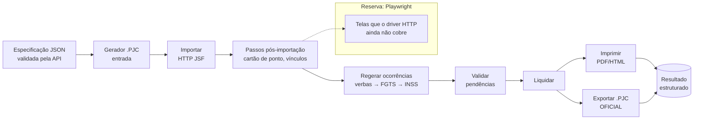
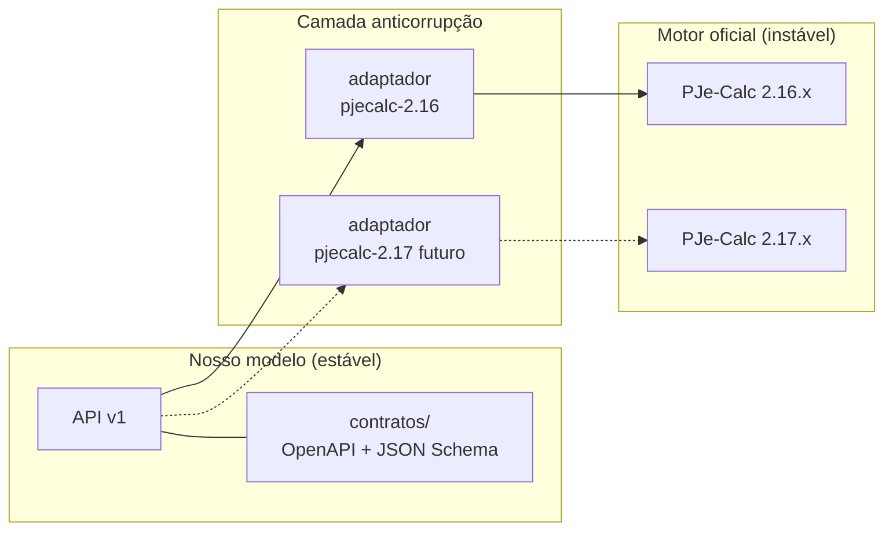

# 04 — Estratégias de integração com o motor

"Usar o motor do PJe-Calc" pode significar coisas bem diferentes. Estas são as seis opções possíveis:

| | Estratégia | Como funciona | Fidelidade | Robustez | Desempenho | Esforço | Risco de quebra em nova versão |
|---|---|---|---|---|---|---|---|
| **1** | **`.PJC` como entrada + driver HTTP da interface** | A API gera o `.PJC`; o adaptador importa pela tela "Importar", regera, valida, liquida e exporta, fazendo `POST`s JSF/A4J como o navegador faria | ★★★★★ (o próprio PJe-Calc calcula e assina) | ★★★★ | ★★★★ (segundos) | Médio-alto | Médio (telas de operação mudam pouco) |
| **2** | **Navegador automatizado** (Playwright) | Um navegador *headless* preenche tela por tela | ★★★★★ | ★★ (seletores, tempos, *locks*) | ★★ (minutos) | Médio | Alto |
| **3** | **Embutir o motor Java** (sem Tomcat) | Chamar `Calculo.liquidar()` numa JVM própria, com Seam/Hibernate inicializados à mão | ★★★ (fora do fluxo de telas, sem *hash* oficial) | ★★ | ★★★★★ | Muito alto | **Muito alto** (APIs internas, reflexão) |
| **4** | **Escrever no banco H2** e liquidar | `INSERT` direto nas tabelas | ★ | ★ | — | Alto | Muito alto. **Proibido**: corrompe as ocorrências e o *hash* |
| **5** | **Reescrever o motor** | Implementar todas as regras em outra linguagem | Depende de anos de paridade | — | ★★★★★ | Enorme | Total (cada mudança legal) |
| **6** | **Somente serviços REST internos** | Usar os endpoints existentes | — | ★★★★★ | ★★★★★ | Baixo | Baixo, mas **não cobre cálculo** (só SELIC, precatórios, tabelas) |

## Decisão: **1 como caminho principal, 2 como reserva, 6 como complemento**

Registrada em [ADR-0001](adr/0001-pjecalc-como-motor-isolado.md) e [ADR-0003](adr/0003-pjc-como-formato-de-troca.md).

**Por que não a 3?** Ela é ótima para **testes** (gerar valores-gabarito), mas sai do fluxo oficial: não grava o
*hash* nem roda as validações Drools da tela e quebra a cada versão. Fica restrita à suíte de testes, como
**oráculo** opcional.

**Por que não a 5?** O *PJe-Calc Reborn* mostra que, mesmo com 569 testes de paridade, o motor ficou
incompleto. E o resultado não teria a "autoridade" do programa oficial.

## Camada anticorrupção

Entre a API e o PJe-Calc existe um **adaptador versionado** (`motor/adaptador`). Ele é o **único** componente que
conhece telas, IDs de campos, `ViewState`, nomes de classes do `.PJC` e enums. A API e a interface falam apenas
o **modelo de domínio próprio** (`contratos/`). Quando sair a versão 2.17, só o adaptador muda.

