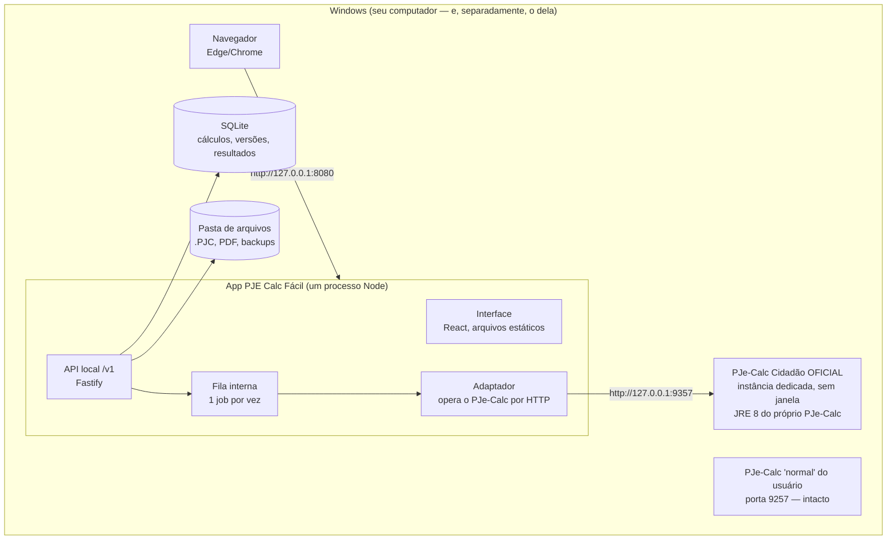
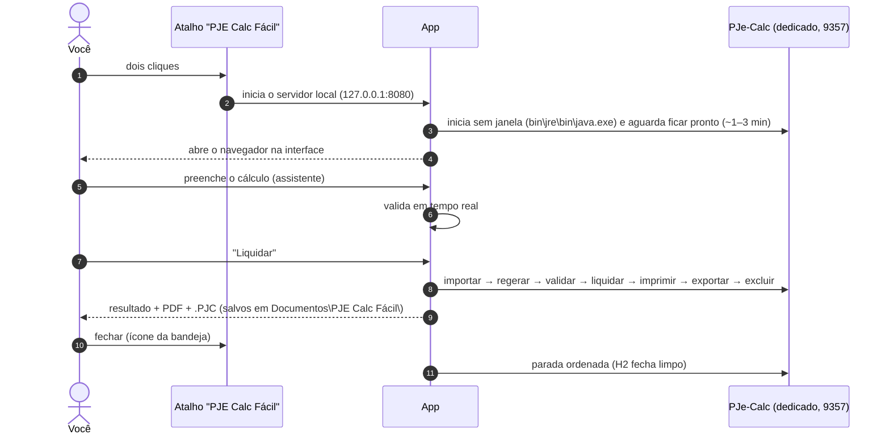
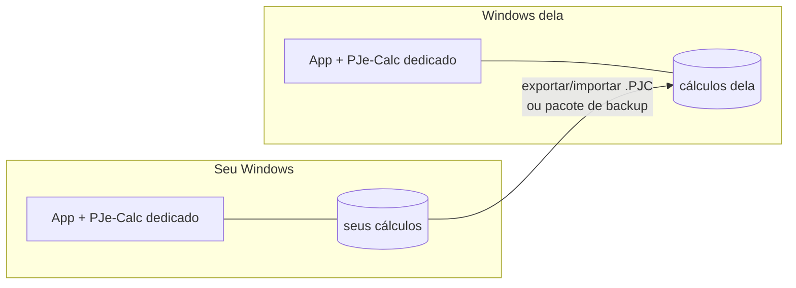

# 05 — Arquitetura proposta (uso pessoal, Windows local)

> Decisão em [ADR-0006](adr/0006-uso-pessoal-local-windows.md). O desenho anterior, de servidor multiusuário, está arquivado em
> `infra/futuro-servidor/` e só volta se a ferramenta um dia for oferecida a terceiros.

## Visão geral: tudo dentro de um Windows

| Peça | Onde fica no Windows | Papel |
|---|---|---|
| **App** (interface + API + adaptador) | `C:\Program Files\PJE Calc Fácil\` (Node portátil + código) | Um só processo; abre o navegador ao iniciar |
| **Dados do app** | `%LOCALAPPDATA%\PJECalcFacil\dados\` (SQLite) e `...\arquivos\` | Especificações versionadas, resultados, `.PJC` e PDFs |
| **Motor** | `%LOCALAPPDATA%\PJECalcFacil\motor\` | **Cópia dedicada** do PJe-Calc oficial que você baixou, na porta **9357** |
| **Seu PJe-Calc normal** | onde você o instalou | Continua funcionando como sempre, na porta 9257 |

### Por que uma instância dedicada do PJe-Calc?
- O adaptador **importa, liquida e exclui** cálculos. Não deve mexer na lista de cálculos que você usa à mão.
- O PJe-Calc trava o banco H2 e a porta 9257. Com uma cópia em outra porta, os dois podem estar abertos ao mesmo tempo.
- Se a cópia do app se corromper, basta recriá-la a partir do PJe-Calc oficial, sem risco para os seus cálculos manuais.

## Como funciona no dia a dia

- O motor pode ser iniciado **já na abertura do app**, em segundo plano, para que a primeira liquidação não espere a partida do PJe-Calc.
- Ao fechar o app, o PJe-Calc dedicado é encerrado de forma ordenada, para não corromper o banco.

## Dois computadores

- Cada máquina é **independente**: instala o PJe-Calc oficial (download do TRT8) e o instalador do app.
- Para levar um cálculo de uma máquina para a outra: **Exportar** → `.PJC` → **Importar** no outro computador. A especificação
  completa (com anotações e histórico) vai num **pacote `.pjcf`** (ZIP com o JSON + `.PJC` + PDF), a definir na Fase 4.
- **Opcional futuro, "modo rede":** um dos computadores funciona como central e o outro acessa pelo navegador na rede local, com senha.
  Fica desligado por padrão (ver [08](08-seguranca-e-lgpd.md)).

## Stack

| Camada | Escolha | Motivo |
|---|---|---|
| Linguagem | TypeScript (Node 22 LTS) | Um idioma só; ver [ADR-0002](adr/0002-stack-typescript.md) |
| API local | Fastify + Zod/TypeBox | Leve, valida por schema, gera OpenAPI |
| Banco | **SQLite** (better-sqlite3) | Um arquivo, sem servidor, ótimo para uso pessoal |
| Fila | Interna (em memória, persistida no SQLite) | Um job por vez; sobrevive a reinício |
| Interface | **React + Vite** (SPA) servida pela própria API | Sem servidor separado; empacota fácil |
| Motor | PJe-Calc Cidadão 2.16.x oficial + JRE 8 que vem com ele | Plataforma oficial (Windows) |
| Instalador | **Inno Setup** + Node portátil | `.exe` comum de Windows: atalhos, desinstalação |
| Bandeja (opcional) | `systray` em Node ou casca Tauri/Electron depois | Abrir/fechar o app, status do motor |

## Desenvolver no Mac, usar no Windows

O PJe-Calc roda no Windows, mas a maior parte do código pode ser escrita e testada no Mac:

| Parte | No Mac | No Windows |
|---|---|---|
| Interface e API | ✅ com **motor simulado** (respostas gravadas dos cálculos-gabarito) | ✅ |
| Gerador de `.PJC`, validações | ✅ (testes unitários) | ✅ |
| Adaptador contra o PJe-Calc real | ❌ | ✅ (testes de integração e gabaritos) |
| Instalador | ❌ (compila no Windows ou em CI Windows) | ✅ |

O motor simulado implementa a mesma interface `OperadorPjeCalc` (ver [`motor/adaptador`](../motor/adaptador/README.md)),
então trocar de simulado para real é só configuração.
