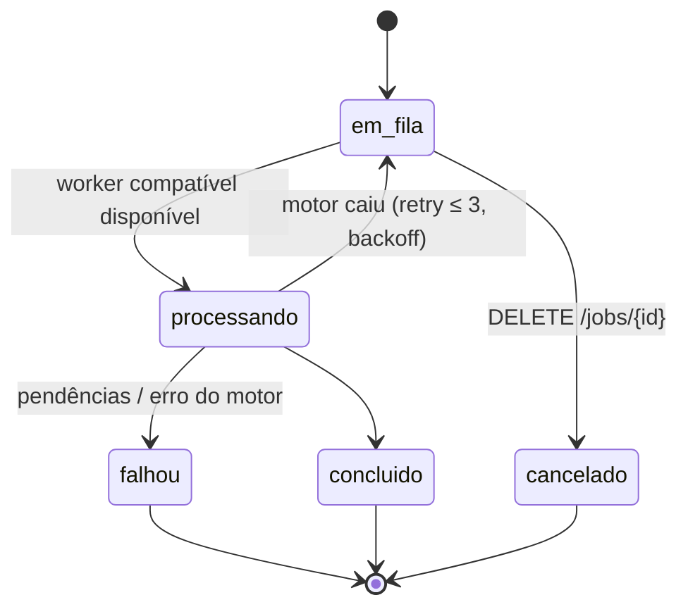

# Jobs, erros e idempotência

## Ciclo de vida de um job



`GET /v1/jobs/{id}` devolve o progresso por etapa, útil para a interface mostrar uma barra:

```json
{
  "id": "job_01J…", "tipo": "liquidacao", "status": "processando",
  "etapas": [
    {"nome": "preparar_arquivo", "status": "concluida", "ms": 120},
    {"nome": "importar", "status": "concluida", "ms": 2300},
    {"nome": "regerar_ocorrencias", "status": "em_andamento"},
    {"nome": "validar", "status": "pendente"},
    {"nome": "liquidar", "status": "pendente"},
    {"nome": "exportar", "status": "pendente"}
  ],
  "motor": {"versaoPjeCalc": "2.16.0", "regional": "TRT4", "hashTabelas": "9f2c…"}
}
```

## Erros (RFC 9457 — `application/problem+json`)

```json
{
  "type": "https://api.<dominio>/erros/pendencias-do-calculo",
  "title": "O PJe-Calc encontrou pendências que impedem a liquidação",
  "status": 422,
  "codigo": "PENDENCIAS_MOTOR",
  "erros": [
    {"caminho": "/verbas/0/periodo/inicio", "codigo": "PERIODO_FORA_DO_CONTRATO",
     "mensagem": "O início da verba é anterior à admissão.", "origem": "api"},
    {"caminho": "/historicoSalarial", "codigo": "MSG_PJECALC", "mensagem": "Não há histórico salarial para 03/2020.",
     "origem": "pjecalc", "mensagemOriginal": "…texto da tela…"}
  ],
  "traceId": "4bf92f3577b34da6a3ce929d0e0e4736"
}
```

| HTTP | Código | Quando |
|---|---|---|
| 400 | `REQUISICAO_INVALIDA` | JSON malformado |
| 401/403 | `NAO_AUTENTICADO` / `ORIGEM_RECUSADA` | Sem token de sessão local, ou `Host`/`Origin` diferente da interface |
| 404 | `NAO_ENCONTRADO` | Cálculo, liquidação ou job inexistente |
| 409 | `VERSAO_DESATUALIZADA` | `If-Match` não confere |
| 413 | `ARQUIVO_GRANDE_DEMAIS` | Upload acima do limite |
| 422 | `ESPECIFICACAO_INVALIDA` · `PENDENCIAS_MOTOR` | Validação |
| 503 | `MOTOR_INDISPONIVEL` | PJe-Calc dedicado parado, iniciando ou com falha (a interface oferece "iniciar motor") |

## Idempotência

`POST` que cria job aceita `Idempotency-Key` (UUID). A mesma chave com o mesmo corpo devolve o **mesmo job** por 24 h;
com corpo diferente, devolve `409`. Isso evita liquidar duas vezes quando a rede falha.
