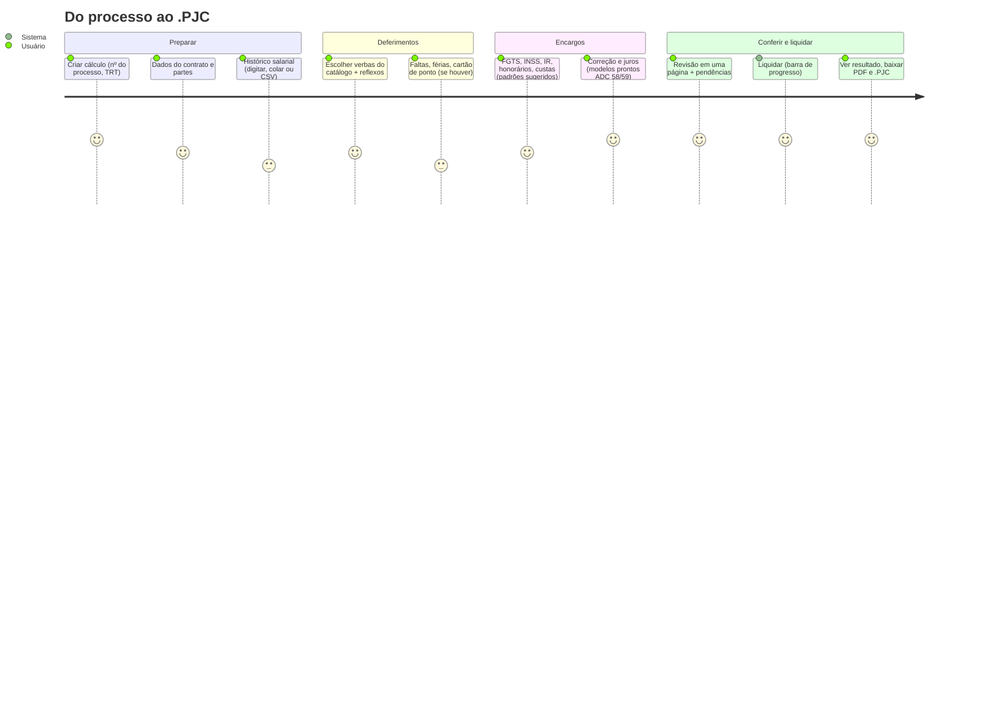

# Interface

Aplicação web para montar, conferir e liquidar cálculos sem a necessidade de percorrer as mais de 30 telas do PJe-Calc.
A interface não executa cálculos; todas as operações passam pela [API](../06-api/README.md).

## Princípios de experiência de uso

| Problema no PJe-Calc | Como a interface resolve |
|---|---|
| Ordem rígida de telas | Assistente por etapas na ordem natural do caso (contrato, salários, verbas deferidas, encargos, atualização), com navegação livre e salvamento automático |
| Terminologia técnica sem explicação | Linguagem simples, ajuda contextual com exemplos e glossário |
| Excesso de campos | Exibição progressiva: padrões do PJe-Calc aplicados e opções avançadas recolhidas |
| Erros identificados apenas na liquidação | Validação contínua (`/validacoes?modo=rapido`) e conferência pelo PJe-Calc antes de liquidar |
| Regeração manual de ocorrências | Executada automaticamente pelo adaptador, na ordem correta |
| Resultado apenas em relatório extenso | Painel com totais (bruto, líquido, encargos), composição, tabela por verba e download do PDF e do `.PJC` |
| Sem histórico | Versões, comparação de cenários, anotações por campo (origem do dado, premissas) |
| Necessidade de abrir o PJe-Calc e aguardar | A aplicação inicia o PJe-Calc em segundo plano e exibe seu estado |

## Jornada principal

## Mapa de telas

| # | Tela | Conteúdo | API |
|---|---|---|---|
| 1 | **Meus cálculos** | Lista, busca, status, duplicar, arquivar | `GET /calculos` |
| 2 | **Novo cálculo** | Nº CNJ (com validação), TRT, partes; ou "Importar .PJC" | `POST /calculos`, `POST /importacoes` |
| 3 | **Contrato** | Datas, tipo de rescisão, aviso prévio, jornada, local (feriados) | `PATCH /calculos/{id}` |
| 4 | **Salários** | Grade por período, colar do Excel, importar CSV, gráfico da evolução | `PATCH`, `POST /importacoes/csv/historico-salarial` |
| 5 | **Verbas deferidas** | Busca no catálogo, cartão por verba com período/base/quantidade, reflexos sugeridos com um clique | `GET /catalogos/verbas` |
| 6 | **Ausências e jornada** | Faltas, férias, cartão de ponto (opcional) | `PATCH` |
| 7 | **Encargos e honorários** | FGTS, INSS, IR, honorários, multas, custas | `PATCH` |
| 8 | **Atualização** | Modelos prontos de correção e juros, com explicação e linha do tempo | `GET /catalogos/indices-correcao` |
| 9 | **Revisão** | Tudo numa página; avisos e pendências com link para o campo | `POST /validacoes` |
| 10 | **Resultado** | Resumo, por verba, encargos, downloads, histórico de liquidações | `GET /liquidacoes/{id}` |
| 11 | **Comparar cenários** | Duas liquidações lado a lado com diferenças | `POST /liquidacoes/{a}/comparar/{b}` |

A estrutura do código está descrita em [`interface/README.md`](../../interface/README.md).

## Acessibilidade e qualidade

- WCAG 2.1 AA: navegação por teclado, contraste e rótulos.
- Valores monetários exibidos no formato brasileiro e enviados à API como decimal com ponto.
- Funcionamento com dados de exemplo, sem uso de dados reais.
