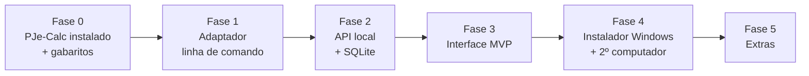

# 10 — Roadmap (uso pessoal, Windows local)

> Revisado após a [ADR-0006](adr/0006-uso-pessoal-local-windows.md). Prazos indicativos, para quem desenvolve nas horas livres.

> **Adiantado (22/10/2026):** protótipo da API local e da interface já construído (sem motor) — partes das Fases 2 e 3.
> Faltam: o adaptador real (Fase 1), a especificação completa (INSS, multas, custas, cartão de ponto) e o instalador.

## Fase 0 — Preparar o terreno (1 semana) ← **você está aqui**
- [x] Instalar o **PJe-Calc Cidadão 2.16.x** oficial no Windows (site do TRT8) e confirmar que abre e liquida.
- [x] Anotar o caminho da instalação e a versão exata (2.16.0, `C:\Program Files\PJE Calc Fácil`).
- [x] Fazer **2 ou 3 cálculos-gabarito à mão** (feitos em 23/10/2026: [gabaritos](../motor/adaptador/testes/gabaritos/README.md)), com dados fictícios ou anonimizados. Sugestão: (1) rescisão simples sem justa causa;
      (2) horas extras com reflexos; (3) adicional de insalubridade com FGTS e honorários. Exportar o `.PJC` e o PDF de cada um para
      `testes/gabaritos/` (pasta ignorada pelo Git se tiver dados reais).
- [x] Instalar no Windows: Git, Node 22 LTS e VS Code (para os testes reais do adaptador).

## Fase 1 — Adaptador (prova de conceito, 3–4 semanas)
**Objetivo:** liquidar os gabaritos **sem abrir a tela do PJe-Calc**, por um comando no terminal.
- Criar a **instância dedicada** (cópia do PJe-Calc oficial, porta 9357, sem AJP) e iniciá-la/pará-la sem janela.
- Operações: `importar`, `regerar`, `pendencias`, `liquidar`, `imprimir`, `exportar`, `excluir`, `catalogoDeVerbas`.
- **Pronto quando:** `pjecalc-facil liquidar gabarito-1.PJC --data 2026-10-31` gera PDF e `.PJC` que batem **ao centavo** com os
  feitos à mão; medir o tempo de partida e de liquidação.

## Fase 2 — API local + especificação (4–6 semanas)
- Especificação de cálculo completa + gerador de `.PJC` de entrada.
- API local (`127.0.0.1:8080/v1`) com SQLite: cálculos versionados, validações, liquidações, catálogos, importação.
- **Motor simulado** para desenvolver no Mac.
- **Pronto quando:** os gabaritos montados **a partir do JSON** (não do `.PJC`) batem ao centavo.

## Fase 3 — Interface MVP (4–8 semanas)
- Telas de [07](07-interface/README.md): assistente, revisão, resultado, downloads.
- **Pronto quando:** você consegue fazer um cálculo real do começo ao fim **mais rápido** que no PJe-Calc direto, sem consultar o manual.

## Fase 4 — Instalador e segundo computador (1–2 semanas)
- Instalador Windows (Inno Setup): Node portátil, atalhos, assistente que **localiza o PJe-Calc** e cria a instância dedicada.
- Ícone na bandeja (abrir, status do motor, sair com parada ordenada), aviso de nova versão, backup/restauração.
- Instalar e testar no **computador da sua namorada**; exportar/importar cálculos entre as duas máquinas.
- Detalhes em [`instalador/`](../instalador/README.md).

## Fase 5 — Extras (quando fizer sentido)
- Execução: atualização com pagamentos, alvarás, precatório/RPV.
- Comparação de cenários; vários reclamantes em lote.
- Extração assistida por IA (sentença, holerites, cartões → rascunho de especificação, sempre revisado por você).
- "Modo rede" entre os dois computadores.

## Riscos principais

| Risco | Prob. | Impacto | Mitigação |
|---|---|---|---|
| Nova versão do PJe-Calc quebra o adaptador | Alta | Médio | Adaptador por versão; rodar os gabaritos antes de atualizar; manter a cópia dedicada na versão testada |
| PJe-Calc dedicado não inicia sem janela | Média | Alto | Fase 1 testa as duas formas (Bootstrap direto do Tomcat ou iniciador próprio) |
| Resultado diferente por tabelas desatualizadas | Média | Alto | App mostra a data e o *hash* das tabelas; botão "Atualizar tabelas" antes de liquidar |
| Memória do notebook (o PJe-Calc usa até 2 GB) | Média | Baixo | Iniciar o motor só quando o app abre e encerrá-lo ao fechar |
