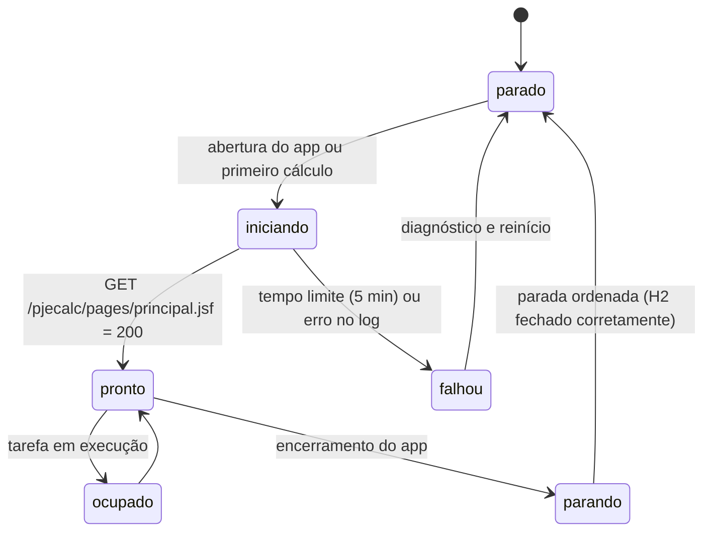

# Runtime do PJe-Calc

Execução da instância dedicada do PJe-Calc Cidadão utilizada pela aplicação.

**Status:** em projeto. Os itens listados em *Pendências de validação* devem ser confirmados no Windows de destino.

## Instância dedicada

| Item | Valor |
|---|---|
| Origem | Instalação oficial do PJe-Calc Cidadão obtida no site do TRT8 (ex.: `C:\pjecalc-windows64-2.16.x\`) |
| Cópia | `%LOCALAPPDATA%\PJECalcFacil\motor\`, criada pelo instalador e recriável a qualquer momento |
| Portas | HTTP 9357 e shutdown 9356, apenas em `127.0.0.1` (a instalação original permanece na 9257) |
| AJP | Removido do `server.xml` da cópia |
| Java | JRE 8 distribuída com o PJe-Calc (`motor\bin\jre\bin\java.exe`) |
| Memória | `-Xms1024m -Xmx2048m` (padrão do `iniciarPjeCalc.bat`) |
| JVM | `-Duser.timezone=GMT-3 -Dfile.encoding=ISO-8859-1 -Djava.awt.headless=true` e token aleatório dos serviços REST |

## Ciclo de vida

## Pendências de validação

- Forma de iniciar sem janela: Tomcat direto (`org.apache.catalina.startup.Bootstrap` com `bin\lib\*.jar`) ou iniciador
  Java próprio que reproduz os passos do lançador oficial sem Swing.
- Parada ordenada com fechamento correto do arquivo `.h2.db`.
- Comportamento do firewall do Windows na primeira execução do `java.exe`; o acesso à rede deve ser negado, pois o uso é local.

## Validado no Windows (23/10/2026, PJe-Calc 2.16.0)

- O lançador oficial (`java -jar bin\pjecalc.jar`) respeita as portas alteradas no `server.xml` da cópia: a instância
  atendeu em 9357 sem tocar na instalação original.
- O lançador **não roda com `-Djava.awt.headless=true`** (`HeadlessException`); iniciar sem janela exige o Tomcat direto
  ou um iniciador próprio.
- O lançador **não abre a porta de shutdown** (9356); a parada ordenada precisa de outro mecanismo. Após encerrar o
  processo à força, o banco H2 voltou íntegro.
- A propriedade `-Dseguranca.pjecalc.tokenServicos` do `iniciarPjeCalc.bat` é obrigatória para a atualização online de
  tabelas.
- Uma instalação nova vem **sem índices de correção e juros**; é preciso executar "Atualização de Tabelas e Índices"
  antes de liquidar.
- Tempos: inicialização em 10 a 14 s; liquidação em cerca de 2,5 s.
- Operação pela interface web e particularidades do JSF: ver [gabaritos](../adaptador/testes/gabaritos/README.md).
